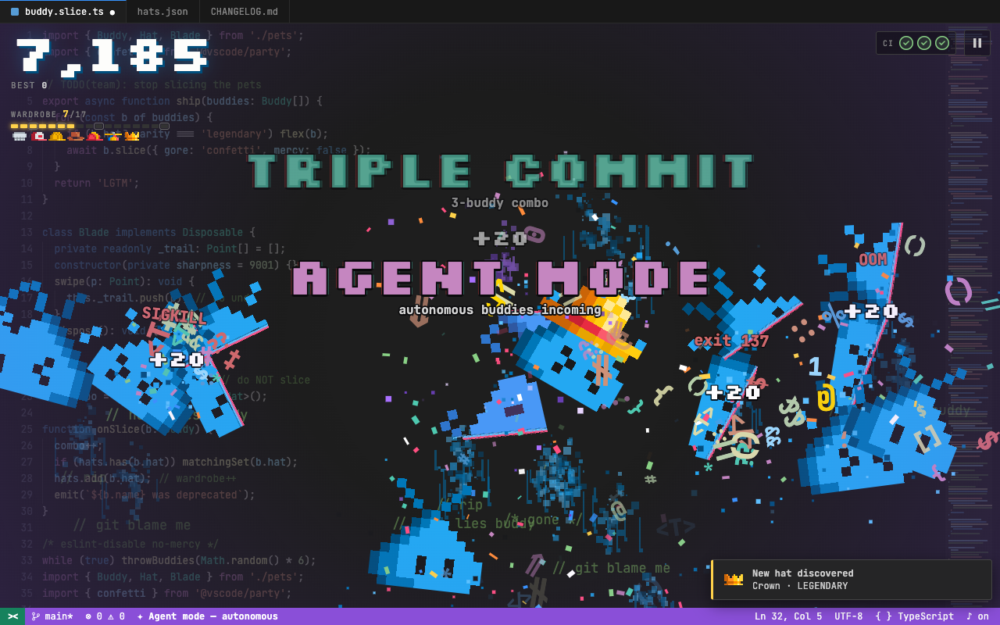
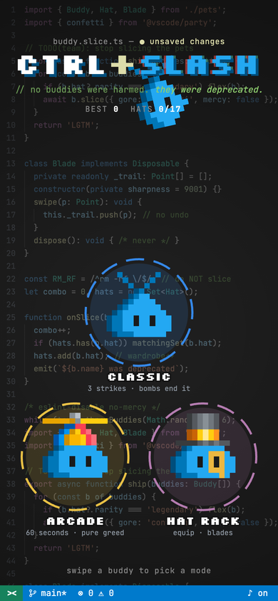

# CTRL+SLASH

A Fruit Ninja-style slicer starring Buddy, the pixel pet from VS Code chat, and all 17 of its hats. Swipe to slice. Don't touch `rm -rf`.

> Unofficial fan art. Not made, affiliated with, or endorsed by Microsoft or the VS Code team.

**Play it:** https://digitarald.github.io/ctrl-slash/

<p>
  
  
</p>

Built mobile-first for touch, and it works with a mouse too. The gore is pixel giblets, flying syntax, and confetti. No blood.

## Modes

- **Classic.** You get 3 CI checks. A buddy that falls off screen "escaped to prod" and costs one. Slicing a bomb ends the run. Every 1,000 points restores a check.
- **Arcade.** 60 seconds. Bombs cost 50 points. The last 10 seconds are crunch time.

## Scoring

A buddy is worth 10 points. Slice 3 or more in one swipe for a combo worth n² × 10, from TRIPLE COMMIT up to SHIPPED TO PROD ON FRIDAY.

Some buddies wear hats, and hats pay extra:

| Bonus | How | Pays |
|---|---|---|
| Rarity | Slice a hatted buddy | 25 / 60 / 150 / 400 by tier |
| Hat snipe | Slice the hat after it pops off | 2× the hat's value |
| Matching set | Same hat 2+ times in one swipe | hat value × n² |
| Runway | 3+ different hats in one swipe | 50 × n² |
| Wardrobe | Distinct hats in one run | 3 = ×2 for 8s, 6 = +400, 10 = ×3, 17 = +5,000 |

Hats you slice are saved to the Hat Rack. The equipped hat shows up 3× more often and recolors your blade.

## Special buddies

- **Breakpoint** (red dot) slows time for 5 seconds.
- **Agent** (sunglasses, purple) sends a 5-second flood of buddies from the sides.
- **Legacy monolith** (giant, dizzy) freezes mid-air. Hit it up to 16 times before it ships.

## Controls

Swipe or drag to slice. On desktop, `1` `2` `3` pick a mode, `P` or `Esc` pauses, `M` mutes, `R` retries.

## Run locally

The game is plain HTML, CSS, and JavaScript with no build step. Serve the folder over HTTP, because the canvas can't read sprite sheets from `file://`:

```sh
python3 -m http.server 8000
```

Then open http://localhost:8000. Pushes to `main` deploy to GitHub Pages through [.github/workflows/pages.yml](.github/workflows/pages.yml).

## Code

| File | Contents |
|---|---|
| `js/core.js` | Constants, hat tiers, sprite rig, asset loading, save data, editor background |
| `js/audio.js` | WebAudio sound effects, synthesized at runtime |
| `js/fx.js` | Particles, stains, popups, banners, screen shake |
| `js/entities.js` | Buddies, bombs, loose hats, sliced halves |
| `js/game.js` | Run state, scoring, hat bonuses, specials, wave spawner |
| `js/input.js` | Pointer trails, hit tests, menu rings |
| `js/ui.js` | HUD, Hat Rack, pause, game-over terminal |
| `js/main.js` | Resize, main loop, keyboard |

## License

Code is MIT, see [LICENSE](LICENSE). The Buddy and hat sprites come from [microsoft/vscode](https://github.com/microsoft/vscode) under its MIT license, see [assets/NOTICE.md](assets/NOTICE.md).

CTRL+SLASH is unofficial fan art and not a Microsoft product. "Visual Studio Code" and "VS Code" are trademarks of Microsoft Corporation.
